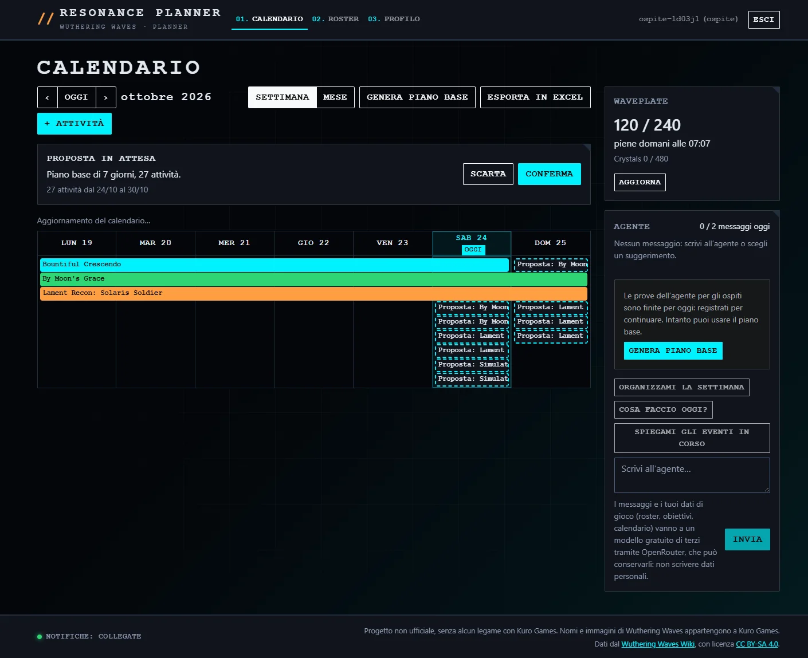
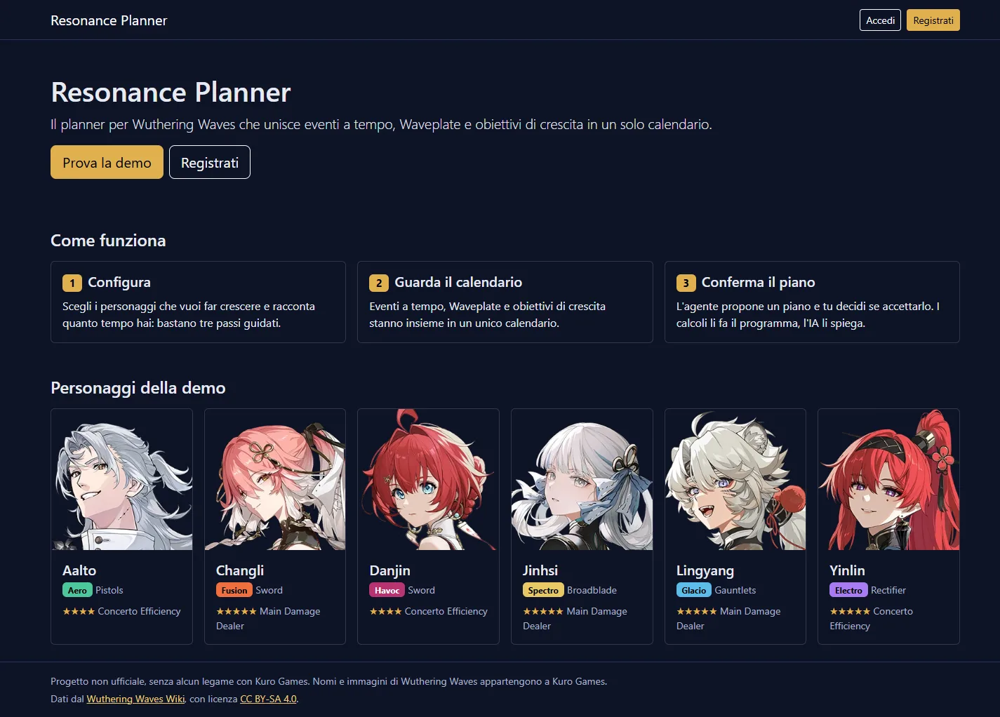
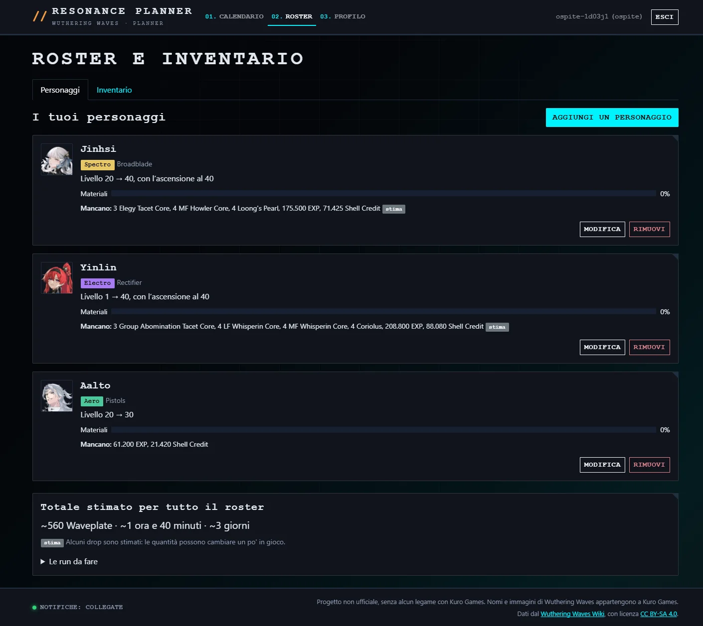
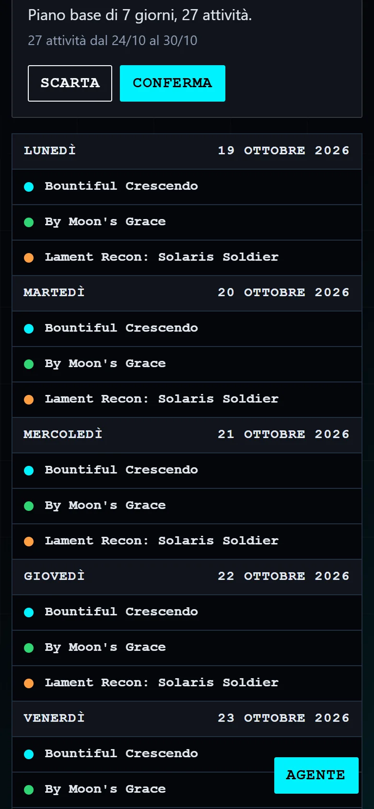
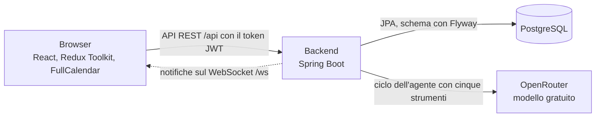

# Resonance Planner

Planner per **Wuthering Waves**: un calendario che unisce eventi a tempo, Waveplate e obiettivi di crescita dei personaggi, con un agente IA che propone un piano che l'utente conferma.

Progetto capstone del Master Full-Stack AI Developer di Epicode. "Resonance Planner" è un nome provvisorio.

> **Stato:** è online la **versione finale** (tag `v3.0.0`, 24/10/2026): calendario, roster e inventario, piano base, proposte da confermare e agente IA con la chat, più tre extra: export del piano in Excel, accesso ospite "Prova la demo" e notifiche in tempo reale. La checklist finale sul sito online è superata in tutti i 19 punti ([`docs/rilascio-v3.md`](docs/rilascio-v3.md)).



## Demo online

| Cosa | Indirizzo |
|---|---|
| Applicazione | https://resonance-planner.onrender.com |
| Documentazione delle API (Swagger) | https://resonance-planner-api.onrender.com/swagger-ui.html |

Per provarla senza registrarsi basta **"Prova la demo"** nella pagina iniziale: crea un account ospite, che si cancella da solo dopo 24 ore.

Il backend usa il piano gratuito di Render: dopo 15 minuti senza richieste si spegne, e la prima richiesta successiva può richiedere fino a tre minuti. L'applicazione lo segnala con un messaggio durante il caricamento.

## Cosa fa

- **Configurazione guidata** in tre passi: personaggi da far crescere, livelli e obiettivi, Waveplate e tempo di gioco.
- **Calendario:**
  - vista a settimana o a mese, e su telefono un elenco per giorno;
  - gli eventi a tempo compaiono solo nei giorni in cui sono davvero attivi;
  - attività manuali con titolo, giorno, durata e note;
  - finestre di dettaglio per eventi e attività, e "Segna come fatta".
- **Waveplate:** il valore attuale lo calcola il server, con l'orario in cui saranno piene; si aggiorna da solo ogni minuto.
- **Roster e inventario:** per ogni personaggio i materiali mancanti; per tutto il roster le run da fare, le Waveplate, il tempo e i giorni stimati.
- **Attività di farming segnate come fatte:** aggiungono all'inventario le ricompense medie. Le ricompense doppie di un evento contano solo entro il suo limite giornaliero.
- **Profilo:** username, tempo di gioco, uscita ed eliminazione dell'account con conferma.
- **Area admin:** creazione, modifica ed eliminazione degli eventi.

**Con la v2:**
- **Piano base:** "Genera piano base" crea un piano di 7 giorni con il pianificatore in Java, senza IA. Funziona sempre, anche quando l'agente non è disponibile.
- **Proposte:** un piano arriva come proposta; nel calendario le sue attività sono tratteggiate, e si conferma o si scarta dalla barra della proposta. Ogni proposta nuova sostituisce quella in attesa.
- **Avviso di cambiamento:** se roster, obiettivi o eventi cambiano dopo l'ultimo piano, il calendario lo dice e propone di rifarlo, con il piano base o con l'agente.
- **Agente IA con la chat:**
  - si chiede in italiano, per esempio "Organizzami la settimana", "Non gioco sabato e domenica" o "Cosa faccio oggi?";
  - l'agente legge roster, eventi, Waveplate e calendario con cinque strumenti, chiede il piano al pianificatore in Java e prepara una proposta con la sua spiegazione;
  - sotto la risposta compaiono i passaggi fatti ("Ho calcolato il piano");
  - "Spiegamelo" nel dettaglio di un evento chiede all'agente di spiegarlo;
  - su computer la chat sta accanto al calendario, su telefono e tablet si apre con il pulsante "Agente".

**Extra:**
- **Esporta in Excel:** dal calendario si scarica un file `.xlsx` con il piano confermato del periodo sullo schermo (foglio "Piano", con i totali) e gli eventi attivi (foglio "Eventi"). Il file lo scrive il backend con Apache POI.
- **Prova la demo:** un clic crea un account ospite, senza email né password. L'ospite fa la stessa configurazione guidata e usa tutta l'app, con limiti più stretti per l'agente; dopo 24 ore l'account e i suoi dati si cancellano da soli.
- **Notifiche in tempo reale:** con la pagina aperta arrivano avvisi quando le Waveplate stanno per riempirsi, quando un evento finisce oggi o domani, e quando l'admin cambia gli eventi (il calendario si aggiorna da solo).

È una demo con un dataset curato: sei personaggi e tre eventi reali del gioco, calcolo dei materiali fino al livello 40.

| Pagina di presentazione | Roster e inventario |
|---|---|
|  |  |

<p align="center">
  
</p>

### L'agente e i suoi limiti

- **Modello gratuito di terzi:** l'agente usa `nvidia/nemotron-3-ultra-550b-a55b:free` tramite [OpenRouter](https://openrouter.ai), un servizio che dà accesso a molti modelli con un'unica API (D126, D132). Il backend accetta solo modelli gratuiti, il cui nome finisce con `:free`. I messaggi e i dati di gioco (roster, obiettivi, calendario) vanno a quel fornitore, che può conservarli: la chat lo dice, e non vanno scritti dati personali.
- **Limiti giornalieri (D129, D134):** il piano gratuito di OpenRouter dà 50 richieste al giorno per tutto l'account, e un messaggio ne usa fino a 6. Per questo:
  - ogni utente ha **5 messaggi al giorno** e al massimo 24 chiamate al modello;
  - ogni ospite ha **2 messaggi al giorno**, e tutti gli ospiti insieme al massimo 18 chiamate;
  - tutta l'app si ferma a 40 chiamate al giorno;
  - un utente può avere un solo messaggio in corso;
  - il piano base si ferma a 20 proposte al giorno per utente (contano anche quelle dell'agente).

  Quando un limite finisce, la chat lo spiega e offre il piano base.
- **Il modello non fa conti e non scrive il calendario:** le attività della proposta sono sempre quelle calcolate da Java; il modello sceglie i parametri e spiega. Le sue risposte si mostrano come testo semplice, mai come HTML.
- **Verifica:** dieci scenari reali, dalla pianificazione alle domande fuori tema e ai tentativi di far ignorare le istruzioni, sono descritti con i risultati in [`docs/scenari-agente.md`](docs/scenari-agente.md).

## Come provarla

1. Apri l'applicazione e scegli **"Prova la demo"** per entrare come ospite, oppure **"Registrati"** per creare un account tuo.
2. Nella configurazione guidata scegli uno o più personaggi, i loro livelli e quanto giochi al giorno.
3. Nel **calendario** guarda gli eventi della settimana e aggiungi un'attività con **"+ Attività"**.
4. Nel **roster** guarda i materiali mancanti; nella scheda **"Inventario"** scrivi quanti materiali hai e i calcoli si aggiornano.
5. Nel calendario prova **"Genera piano base"**, oppure scrivi all'agente nella chat, per esempio "Organizzami la settimana"; poi conferma o scarta la proposta.
6. Con **"Esporta in Excel"** scarichi il piano confermato della settimana.
7. Dal **profilo** puoi eliminare l'account: spariscono anche tutti i tuoi dati.

## Come funziona



- **Frontend:** un'applicazione React su un sito statico. Tutte le chiamate passano da un unico client HTTP, che manda il token JWT nell'header `Authorization`.
- **Backend:** API REST con Spring Boot. I dati personali stanno solo sotto `/api/me` e l'utente si ricava sempre dal token. Waveplate, materiali mancanti, run e piano giorno per giorno sono calcolati in Java.
- **Un messaggio all'agente:** il backend manda al modello la domanda con cinque strumenti (`get_player_status`, `get_events`, `get_calendar`, `plan_schedule`, `create_plan_proposal`). Il modello chiede i dati e sceglie i parametri del piano; Java esegue ogni strumento e gli restituisce il risultato, per al massimo 6 giri. La proposta salvata è sempre l'ultimo piano calcolato dal pianificatore, mai un testo scritto dal modello.
- **Notifiche:** il browser apre il WebSocket solo a pagina visibile e manda il token nel primo messaggio, mai nell'indirizzo. Il backend controlla ogni minuto gli utenti collegati e decide cosa avvisare. Il protocollo è in [`docs/05-api.md`](docs/05-api.md), perché il WebSocket non compare in Swagger.

## Scelte principali

- **I calcoli li fa Java:** l'agente sceglie i parametri e spiega il piano, ma non fa conti.
- **L'agente propone, l'utente conferma:** un piano entra nel calendario solo dopo la conferma.
- **C'è sempre un piano senza IA:** il piano base usa lo stesso pianificatore dell'agente e non dipende dal modello.
- **Sicurezza:**
  - password con BCrypt e token JWT valido 24 ore;
  - ruoli USER, ADMIN e GUEST, controllati sul server a ogni richiesta;
  - limiti al numero di richieste;
  - una Content-Security-Policy stretta sul sito.
- **Registro delle decisioni:** ogni scelta ha la sua voce in [`docs/decisioni.md`](docs/decisioni.md), con le alternative scartate.

## Stack

| Parte | Tecnologie | Versioni |
|---|---|---|
| Frontend | React + TypeScript con Vite, Redux Toolkit, React Router, Bootstrap + SASS, FullCalendar | Node 24 (almeno 24.15), React 19.3, Vite 8.3, TypeScript 6.0, Redux Toolkit 2.13, React Router 8.4, Bootstrap 5.3, FullCalendar 7.1 |
| Backend | Java, Spring Boot, Maven, Spring Data JPA, Spring Security + JWT, springdoc, Apache POI per l'export Excel, WebSocket di Spring (senza STOMP) | Java 21, Spring Boot 4.1.1, Maven 3.10 (wrapper incluso), springdoc 3.1.1, Apache POI 5.5.1 |
| Database | PostgreSQL, schema gestito con Flyway | PostgreSQL 16 |
| IA | OpenRouter con un modello gratuito (`nvidia/nemotron-3-ultra-550b-a55b:free`), chiamato con `RestClient` di Spring; ciclo con gli strumenti scritto da noi (D126, D132) | — |
| Deploy | Render (sito statico, backend Docker, database) | — |

## Struttura del repository

```
backend/                   API Spring Boot
  src/main/java/...        un pacchetto per funzionalità: auth, roster, farming, event, planning, planner, agent, notification...
  src/main/resources/
    db/migration/          schema del database (Flyway)
    data/                  dati di gioco in JSON, con fonti e stime
frontend/                  applicazione React
  src/features/            una cartella per funzionalità: calendar, chat, roster, onboarding, notifications...
  src/api/client.ts        l'unico client HTTP
docs/                      progettazione: scope, flussi, modello dati, API, agente, schermate, regole, task, decisioni
docker-compose.yml         PostgreSQL per lo sviluppo
.env.example               variabili d'ambiente, senza valori
```

La progettazione completa è in [`docs/`](docs/README.md).

## Variabili d'ambiente

Le variabili obbligatorie stanno in un solo file `.env` nella cartella principale: lo leggono Docker Compose, il backend e il frontend. Si parte da [`.env.example`](.env.example), e il file `.env` non entra mai nel repository. Se manca una variabile obbligatoria, il backend non parte e il messaggio indica quale.

| Variabile | A cosa serve | Valore per il locale |
|---|---|---|
| `DATABASE_URL` | Indirizzo JDBC del database | `jdbc:postgresql://localhost:5433/resonance_planner` |
| `DATABASE_USERNAME`, `DATABASE_PASSWORD` | Utente del database | A scelta, solo lettere e cifre: Docker Compose crea l'utente con questi valori al primo avvio |
| `JWT_SECRET` | Chiave che firma i token, almeno 32 caratteri casuali | L'uscita di `node -e "console.log(require('crypto').randomBytes(32).toString('hex'))"` |
| `OPENROUTER_API_KEY` | Chiave di OpenRouter per l'agente | Una chiave creata con un account gratuito su [openrouter.ai](https://openrouter.ai) (vedi sotto) |
| `OPENROUTER_MODEL` | Modello dell'agente: deve finire con `:free` | `nvidia/nemotron-3-ultra-550b-a55b:free` |
| `ADMIN_EMAIL`, `ADMIN_PASSWORD` | Account admin, creato all'avvio | Un'email e una password a scelta |
| `CORS_ALLOWED_ORIGINS` | Indirizzo del frontend che può chiamare il backend | `http://localhost:5173` |
| `VITE_API_BASE_URL` | Indirizzo del backend, scritto nel frontend al build | `http://localhost:8080` |

I valori si scrivono senza virgolette e senza barre rovesciate.

**Senza una chiave di OpenRouter** il resto dell'app funziona: si scrive un valore qualsiasi senza spazi (per esempio `nessuna`), il backend parte e la chat risponde che l'agente non è disponibile, mentre il piano base funziona sempre.

**Facoltative.** Cambiano i limiti di richieste e dell'agente. Vanno impostate come variabili d'ambiente del sistema o della shell (su Render, nella pagina Environment del servizio): **scritte nel `.env` vengono ignorate**. Per esempio, in bash `APP_AGENTLIMITS_DAILYMESSAGES=10 ./mvnw spring-boot:run`; in PowerShell `$env:APP_AGENTLIMITS_DAILYMESSAGES = "10"` e poi `.\mvnw.cmd spring-boot:run`. Senza queste variabili valgono i valori predefiniti:

| Variabile | Predefinito |
|---|---|
| `APP_RATELIMIT_AUTHATTEMPTS` | 10 tentativi di login, e altrettanti di registrazione, per indirizzo |
| `APP_RATELIMIT_AUTHWINDOW` | 15 minuti; un numero semplice vale minuti |
| `APP_RATELIMIT_GENERALREQUESTS` | 120 richieste per indirizzo, per tutte le altre API |
| `APP_RATELIMIT_GENERALWINDOW` | 60 secondi; un numero semplice vale secondi |
| `APP_RATELIMIT_GUESTCREATIONS` | 5 ospiti per indirizzo, nella stessa finestra del login |
| `APP_AGENTLIMITS_DAILYMESSAGES` | 5 messaggi all'agente al giorno per utente |
| `APP_AGENTLIMITS_DAILYUSERMODELCALLS` | 24 chiamate al modello al giorno per utente |
| `APP_AGENTLIMITS_DAILYMODELCALLS` | 40 chiamate al modello al giorno in tutta l'app |
| `APP_AGENTLIMITS_CONCURRENTTURNS` | 2 messaggi all'agente in corso insieme, in tutta l'app |
| `APP_AGENTLIMITS_DAILYBASICPLANS` | 20 proposte al giorno per utente |
| `APP_AGENTLIMITS_GUESTDAILYMESSAGES` | 2 messaggi al giorno per ospite |
| `APP_AGENTLIMITS_GUESTDAILYMODELCALLS` | 18 chiamate al modello al giorno per tutti gli ospiti insieme |

## Avvio in locale

Servono **Git**, **Docker Desktop** (avviato), un **JDK 21** (per esempio Eclipse Temurin) e **Node.js 24.15** o più recente.

**1. Clonare il repository**

```bash
git clone https://github.com/CristianNunezJorge/resonance-planner.git
cd resonance-planner
```

**2. Preparare il file `.env`**

```bash
cp .env.example .env
```

In PowerShell: `Copy-Item .env.example .env`. Poi si completano i valori come nella tabella delle [variabili d'ambiente](#variabili-dambiente).

**3. Avviare il database**

```bash
docker compose up -d
```

PostgreSQL 16 parte sulla porta **5433**, per non scontrarsi con un PostgreSQL già installato, con il database `resonance_planner`.

**4. Avviare il backend** (dalla cartella `backend/`)

```bash
cd backend
./mvnw spring-boot:run
```

In PowerShell il comando è `.\mvnw.cmd spring-boot:run`. Se `java -version` non mostra la versione 21, prima si imposta `JAVA_HOME` sulla cartella del JDK 21.

Al primo avvio Flyway crea lo schema, e il backend carica il catalogo, gli eventi della demo e l'account admin. Il backend è pronto quando http://localhost:8080/actuator/health risponde con `"status":"UP"`; Swagger è su http://localhost:8080/swagger-ui.html.

**5. Avviare il frontend** (in un altro terminale, dalla cartella `frontend/`)

```bash
cd frontend
npm install
npm run dev
```

Si apre http://localhost:5173: "Prova la demo" entra come ospite e "Registrati" crea un account. Con `ADMIN_EMAIL` e `ADMIN_PASSWORD` si entra come admin, e nella barra compare "Eventi".

**Se qualcosa non va**

- `docker compose up` dice "Set DATABASE_USERNAME in .env": il file `.env` manca o non ha quel valore.
- Il backend si ferma con un messaggio come "set the JWT_SECRET environment variable": manca quella variabile nel `.env`.
- Il backend non si collega al database: Docker Desktop deve essere avviato e `docker compose ps` deve mostrare il container `resonance-planner-db`. Se utente o password sono cambiati dopo il primo avvio, il database ha ancora quelli vecchi: `docker compose down -v` lo cancella e al riavvio si ricrea con i nuovi.
- Le porte 5433, 8080 e 5173 devono essere libere.
- `npm install` può avvisare che `@parcel/watcher` ha uno script di installazione non approvato: è solo un avviso, e l'app funziona senza.

## Controlli

Da lanciare prima di ogni pull request:

```bash
# Backend, dalla cartella backend/: compilazione e jar in target/
./mvnw package

# Frontend, dalla cartella frontend/: lint, controllo dei tipi e build
npm run lint
npm run typecheck
npm run build
```

Le prove sul sito online sono nelle checklist di rilascio, [`docs/rilascio-v1.md`](docs/rilascio-v1.md), [`docs/rilascio-v2.md`](docs/rilascio-v2.md) e [`docs/rilascio-v3.md`](docs/rilascio-v3.md), e negli scenari dell'agente, [`docs/scenari-agente.md`](docs/scenari-agente.md).

## Limiti noti

- **Render gratuito:** il backend si sveglia in circa tre minuti, e il database gratuito scade dopo 30 giorni e va ricreato.
- **Fuso orario:** "oggi" è sempre in ora italiana, per tutti gli utenti (D41).
- **Token:** dopo "Esci" il token resta tecnicamente valido fino alla scadenza, 24 ore; se l'account viene eliminato, il server rifiuta comunque le sue richieste (D45, D102).
- **Dataset curato:** sei personaggi, tre eventi, livelli fino al 40. Alcune quantità medie sono stime, e l'applicazione lo segnala.
- **Pianificatore:** sceglie giorno per giorno la soluzione migliore, senza risparmiare Waveplate in vista di eventi futuri (D57).
- **Ricompense doppie:** nel calendario si vede il limite giornaliero di un evento, ma non ancora quante ricompense doppie restano quel giorno.
- **Agente gratuito:**
  - il modello può essere lento (da qualche secondo a un minuto) o non disponibile se il suo unico fornitore gratuito si ferma: resta il piano base, e si può passare a un altro modello gratuito cambiando `OPENROUTER_MODEL`;
  - con 50 richieste al giorno per tutto l'account, l'agente basta per circa 10 messaggi al giorno in tutta l'app;
  - a volte la spiegazione aggiunge un motivo che il piano non dà: i numeri da seguire sono quelli delle attività nel calendario;
  - i passaggi mostrati sotto una risposta si perdono ricaricando la pagina.
- **Export Excel:** il file è una fotografia del piano al momento del download. Online la prima esportazione dopo un avvio del server impiega circa 14 secondi (D133).
- **Ospiti:** al massimo 50 insieme; dopo 24 ore l'account e i suoi dati si cancellano (D134).
- **Notifiche:** arrivano solo con la pagina aperta e visibile. Online, dietro il proxy di Render, i codici di chiusura decisi dal server non arrivano al browser, che si ricollega da solo (D135).

## Documentazione

- [`docs/README.md`](docs/README.md): indice delle fasi di progettazione.
- [`docs/decisioni.md`](docs/decisioni.md): registro delle decisioni, con le alternative scartate.
- [`docs/05-api.md`](docs/05-api.md): endpoint, esempi, limiti di richieste e protocollo del WebSocket.
- [`docs/06-agente.md`](docs/06-agente.md): strumenti, istruzioni e sicurezza dell'agente.

## Crediti

- Wuthering Waves, i suoi nomi e le sue immagini appartengono a **Kuro Games**. Progetto didattico non commerciale.
- Dati di gioco dal [Wuthering Waves Wiki](https://wutheringwaves.fandom.com) su Fandom, con licenza [CC BY-SA](https://www.fandom.com/licensing). Fonti e stime sono elencate in [`backend/src/main/resources/data/README.md`](backend/src/main/resources/data/README.md).

## In English

Resonance Planner is a planner for the game Wuthering Waves, built as the capstone project of the Epicode Full-Stack AI Developer master. It is online: a calendar that shows time-limited events only on the days they are active, manual tasks, the Waveplate stamina counter, the roster and inventory with the materials still missing for each character, a profile page and an admin area for events. On top of that, a basic plan built without AI, plans shown as proposals to confirm or discard, and an AI agent with a chat, running on a free model through OpenRouter: it reads the user's data through five tools, asks the Java planner for a day-by-day plan and explains it, with daily limits that keep it within the free quota. Three extras complete it: an Excel export of the plan made with Apache POI, a one-click guest account ("Prova la demo") deleted after 24 hours, and real-time notifications over a plain WebSocket. The Java backend does all the calculations, and the user always confirms the plan. Stack: React + TypeScript, Spring Boot, PostgreSQL, deployed on Render. To run it locally you need Docker Desktop, JDK 21 and Node.js 24: copy `.env.example` to `.env`, then run `docker compose up -d`, `./mvnw spring-boot:run` in `backend/` and `npm install && npm run dev` in `frontend/` (see "Avvio in locale").
