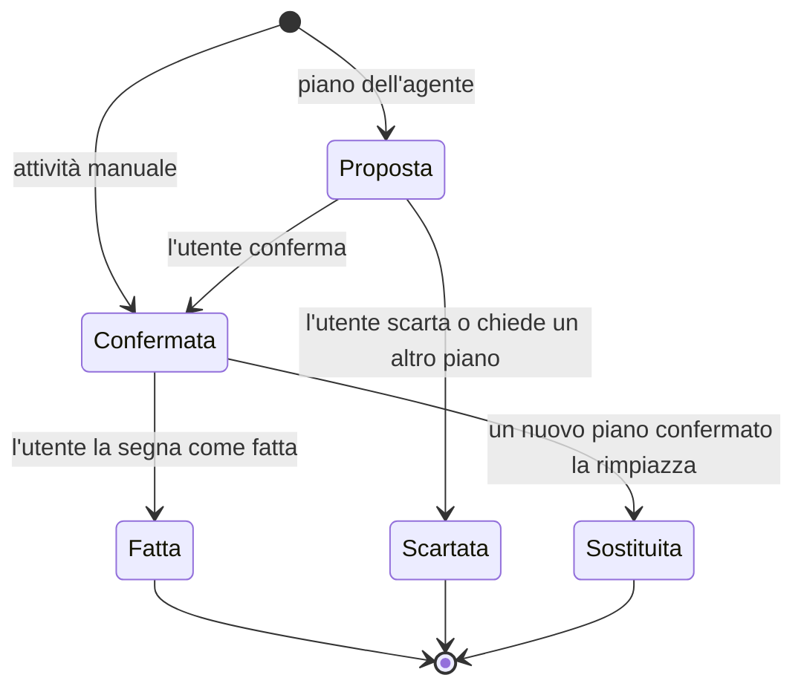

# 2. Utenti e flussi

**Stato:** completata · 01/10/2026

## Ruoli

| Ruolo | Chi è | Cosa può fare |
|---|---|---|
| Visitatore | Non ha fatto login | Vede la pagina di presentazione, si registra, fa login |
| USER | Chi gioca, registrato | Configurazione guidata, roster, inventario, Waveplate, calendario, attività manuali, agente |
| ADMIN | Chi gestisce la demo | Tutto quello che fa USER, più la gestione degli eventi |
| GUEST (v3) | Entra con "Prova la demo" | Come USER; l'account viene cancellato dopo qualche giorno (D15) |

L'account ADMIN si crea all'avvio da variabili d'ambiente, non con la registrazione (D19).

## Mappa delle pagine

| Pagina | Chi la vede |
|---|---|
| Presentazione | Tutti |
| Registrazione, Login | Visitatore |
| Configurazione guidata | USER al primo accesso |
| Calendario, con la chat dell'agente a lato | USER, ADMIN |
| Roster e inventario | USER, ADMIN |
| Profilo (tempo di gioco, logout, eliminazione account) | USER, ADMIN |
| Gestione eventi | ADMIN |

La chat si apre a lato del calendario: così l'anteprima del piano proposto si vede direttamente nel calendario. Le bozze delle pagine sono il compito della fase 7.

## Flussi

### F1 · Registrazione
1. Il visitatore apre la registrazione e inserisce username, email e password.
2. Il backend controlla i dati, salva l'utente con la password cifrata e restituisce il token.
3. L'utente entra e va alla configurazione guidata.

**Se qualcosa va storto:** email già registrata o password troppo corta → messaggio sotto il campo da correggere.

### F2 · Login
1. L'utente inserisce email e password.
2. Il backend restituisce un token JWT, che il frontend allega a ogni richiesta.
3. Se la configurazione non è completa l'utente va lì, altrimenti al calendario.

**Se qualcosa va storto:** credenziali errate → un messaggio unico ("Email o password non corrette") senza dire quale dei due è sbagliato. Token scaduto → si torna al login.

Dove salvare il token nel browser lo decidiamo nella fase 5.

### F3 · Configurazione guidata (D20)
1. **Personaggi:** l'utente sceglie uno o più personaggi tra i sei della demo.
2. **Livelli:** per ognuno indica il livello attuale (1-40, specificando se al 20 ha già fatto l'ascensione) e l'obiettivo (dal livello attuale fino a 40, con o senza ascensione).
3. **Waveplate e tempo:** indica le Waveplate che ha ora (0-240) e quanto gioca al giorno (30 minuti, 1 ora, 2 ore).
4. Arriva al calendario, con un invito a chiedere all'agente di organizzargli la settimana.

**Se qualcosa va storto:** nessun personaggio scelto o obiettivo più basso del livello attuale → il passo non va avanti e spiega cosa correggere.

### F4 · Consultare il calendario
1. Il calendario si apre sulla settimana corrente; si può passare alla vista mensile.
2. Gli eventi appaiono come barre lunghe più giorni, con un colore per tipo. Le attività appaiono dentro il giorno, con il loro stato.
3. Cliccando un evento si apre il dettaglio: descrizione, date, ricompense e un pulsante "Spiegamelo" che chiede all'agente.
4. Cliccando un'attività si apre il dettaglio: si può segnare come fatta e, se è manuale, modificarla o cancellarla.

### F5 · Aggiornare le Waveplate
1. Un riquadro sempre visibile mostra le Waveplate attuali (calcolate dall'ultimo aggiornamento) e l'orario in cui saranno piene.
2. L'utente clicca "Aggiorna" e inserisce il valore che vede nel gioco.
3. Il backend salva il valore insieme all'orario.

### F6 · Chiedere un piano all'agente
1. L'utente apre la chat e scrive, oppure sceglie un suggerimento ("Organizzami la settimana", "Spiegami l'evento", "Cosa faccio oggi?").
2. Mentre l'agente lavora, la chat mostra un indicatore di attesa. Con la risposta arriva l'elenco dei passaggi fatti ("Ho letto il tuo roster", "Ho calcolato il piano") (D62).
3. L'agente risponde con una spiegazione. Se ha preparato un piano, l'anteprima compare nel calendario con un aspetto diverso, tratteggiato.
4. L'utente sceglie **Conferma** o **Scarta**.
   - Conferma: le attività entrano nel calendario; quelle future e non fatte del piano precedente dell'agente vengono sostituite (D22).
   - Scarta: la proposta viene archiviata come rifiutata.
5. L'utente può chiedere correzioni ("sposta tutto nel weekend"): l'agente prepara una nuova proposta che sostituisce quella in attesa.

**Se qualcosa va storto:** limite giornaliero di richieste raggiunto → messaggio con l'orario in cui si potrà riprovare. API IA non raggiungibile → messaggio chiaro; il resto dell'app continua a funzionare.

### F7 · Segnare un'attività come fatta
1. L'utente segna l'attività come fatta.
2. Se è un'attività di farming, l'app aggiunge all'inventario la quantità media prevista di quel materiale (D21).
3. I materiali mancanti nel roster si aggiornano.

### F8 · Modificare roster, obiettivi o inventario
1. Dalla pagina del roster l'utente aggiunge o rimuove personaggi, cambia livelli e obiettivi, corregge l'inventario.
2. Il calendario non cambia da solo: mostra un avviso che invita a chiedere all'agente un piano aggiornato (D23).

### F9 · Attività manuali (D24)
1. L'utente crea un'attività con titolo, giorno, durata e note.
2. Può modificarla o cancellarla quando vuole.
3. Un nuovo piano dell'agente non la tocca.

### F10 · Gestione eventi (ADMIN)
1. L'admin apre la gestione eventi: una tabella con tutti gli eventi.
2. Crea, modifica o cancella un evento: nome, tipo, descrizione, date, ricompense ed eventuale effetto (per esempio ricompense doppie su un contenuto).
3. Gli utenti vedono subito l'evento nel calendario, insieme all'avviso di D23.

Gli eventi del file demo hanno date relative a oggi (D12); quelli creati dall'admin hanno date normali.

### F11 · Logout
1. L'utente clicca "Esci" dal profilo.
2. Il token viene cancellato dal browser e si torna alla presentazione.

### F12 · Eliminazione dell'account (D42)
1. Dal profilo l'utente clicca "Elimina account".
2. L'app chiede di confermare scrivendo la propria email, perché l'operazione non si può annullare.
3. Il backend cancella l'utente e tutti i suoi dati; si torna alla presentazione.

## Ciclo di vita di un'attività

Solo le attività che vengono da un piano dell'agente possono diventare *scartate* o *sostituite*. Quelle manuali nascono già *confermate* e un nuovo piano non le tocca.
