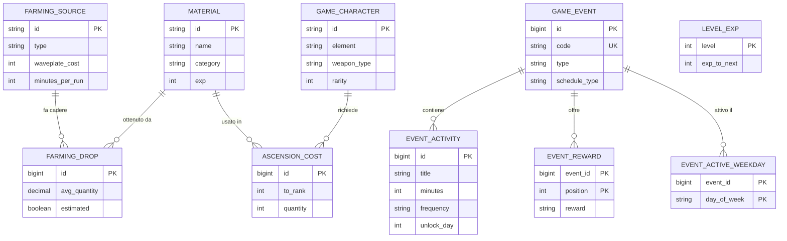
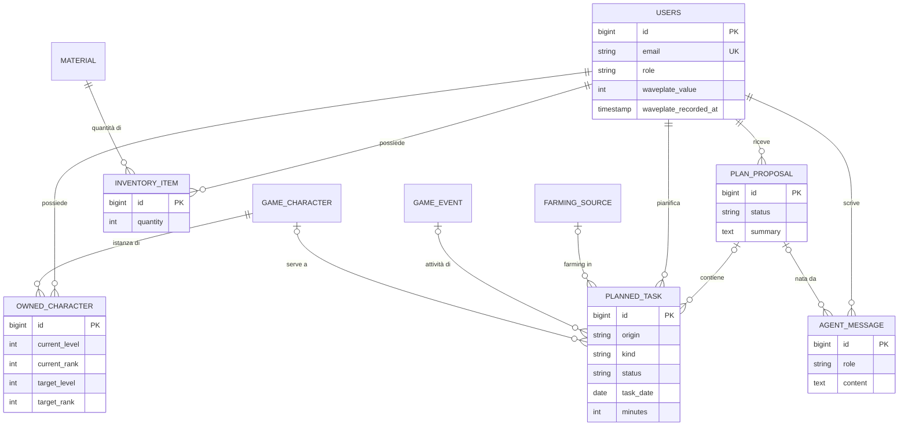

# 4. Modello dati

**Stato:** completata · 01/10/2026 · aggiornata il 02/10/2026 con D93, D94 e D96

Il database è PostgreSQL. Le tabelle si dividono in quattro gruppi:

| Gruppo | Tabelle | Chi le scrive |
|---|---|---|
| Catalogo di gioco | `material`, `farming_source`, `farming_drop`, `level_exp`, `game_character`, `ascension_cost` | Solo il caricamento dai JSON (D39) |
| Eventi | `game_event`, `event_active_weekday`, `event_activity`, `event_reward` | Caricamento dai JSON e area admin |
| Dati dell'utente | `users`, `owned_character`, `inventory_item` | L'utente |
| Pianificazione e agente | `plan_proposal`, `planned_task`, `agent_message` | L'utente e l'agente |

## Diagramma: catalogo ed eventi

## Diagramma: utente, pianificazione e agente

## Tabelle

Per ogni tabella: colonne, tipi PostgreSQL e regole. Tutte le chiavi esterne sono `NOT NULL` salvo dove indicato.

### Catalogo di gioco

**`material`**
| Colonna | Tipo | Regole |
|---|---|---|
| `id` | `varchar(60)` | Chiave primaria, es. `lf-howler-core` (D32) |
| `name` | `varchar(100)` | Obbligatorio |
| `category` | `varchar(30)` | `CREDIT`, `CHARACTER_EXP`, `ENEMY_DROP`, `BOSS_DROP`, `LOCAL_SPECIALTY` |
| `exp` | `integer` | Solo per `CHARACTER_EXP` |
| `icon` | `varchar(200)` | Facoltativo, percorso dell'icona |

**`farming_source`**: dove si ottengono i materiali.
| Colonna | Tipo | Regole |
|---|---|---|
| `id` | `varchar(60)` | Chiave primaria, es. `sim-resonance-potion` |
| `name` | `varchar(120)` | Obbligatorio |
| `type` | `varchar(30)` | `SIMULATION_TRAINING`, `BOSS_CHALLENGE`, `OVERWORLD_ENEMIES`, `OVERWORLD_COLLECTION` |
| `waveplate_cost` | `integer` | ≥ 0 (0 per l'esplorazione) |
| `minutes_per_run` | `integer` | > 0, stima nostra (D31) |

**`farming_drop`**: cosa fa cadere ogni fonte, in media.
| Colonna | Tipo | Regole |
|---|---|---|
| `id` | `bigint` | Chiave primaria generata |
| `farming_source_id` | `varchar(60)` | → `farming_source` |
| `material_id` | `varchar(60)` | → `material` |
| `avg_quantity` | `numeric(8,2)` | > 0, quantità media per run |
| `estimated` | `boolean` | `true` se il numero è una nostra stima (D25) |

Unico: (`farming_source_id`, `material_id`).

**`level_exp`**
| Colonna | Tipo | Regole |
|---|---|---|
| `level` | `integer` | Chiave primaria |
| `exp_to_next` | `integer` | > 0, EXP per passare al livello successivo |

Il costo in Shell Credit si ricava dall'EXP con la regola `shellCreditPerExp` (D93).

**`game_character`**
| Colonna | Tipo | Regole |
|---|---|---|
| `id` | `varchar(60)` | Chiave primaria, es. `jinhsi` |
| `name` | `varchar(100)` | Obbligatorio |
| `element` | `varchar(20)` | `AERO`, `ELECTRO`, `FUSION`, `GLACIO`, `HAVOC`, `SPECTRO` |
| `weapon_type` | `varchar(20)` | `BROADBLADE`, `SWORD`, `PISTOLS`, `GAUNTLETS`, `RECTIFIER` |
| `rarity` | `smallint` | 4 o 5 |
| `role` | `varchar(60)` | Obbligatorio, es. "Main Damage Dealer" |
| `icon` | `varchar(200)` | Facoltativo (D30) |

**`ascension_cost`**: una riga per ogni materiale di ogni ascensione (D34).
| Colonna | Tipo | Regole |
|---|---|---|
| `id` | `bigint` | Chiave primaria generata |
| `character_id` | `varchar(60)` | → `game_character` |
| `to_rank` | `smallint` | ≥ 1: l'ascensione che porta a questo grado |
| `material_id` | `varchar(60)` | → `material` |
| `quantity` | `integer` | > 0 |

Unico: (`character_id`, `to_rank`, `material_id`).

### Eventi

**`game_event`**
| Colonna | Tipo | Regole |
|---|---|---|
| `id` | `bigint` | Chiave primaria generata |
| `code` | `varchar(60)` | Unico, facoltativo: l'identificativo del JSON per gli eventi della demo; vuoto per quelli creati dall'admin |
| `name` | `varchar(120)` | Obbligatorio |
| `type` | `varchar(30)` | `COMBAT_STAGES`, `DOUBLE_DROP`, `POINTS_SHOP` (D18, D95) |
| `description` | `text` | Obbligatorio |
| `schedule_type` | `varchar(20)` | `RECURRING` per gli eventi della demo (D29), `FIXED` per quelli con date normali |
| `start_date`, `end_date` | `date` | Solo `FIXED`; fine ≥ inizio |
| `start_offset_days`, `duration_days`, `repeat_every_days` | `integer` | Solo `RECURRING`; durata > 0, ripetizione ≥ durata |
| `effect_type` | `varchar(30)` | Facoltativo: `DROP_MULTIPLIER` |
| `effect_source_type` | `varchar(30)` | Facoltativo: il tipo di fonte potenziato, per esempio `SIMULATION_TRAINING` (D94) |
| `effect_multiplier` | `numeric(4,2)` | Facoltativo, > 1 |
| `effect_daily_limit` | `smallint` | Facoltativo, > 0: quante run al giorno ricevono il moltiplicatore; vuoto = tutte (D94) |

Controlli: i campi della data devono corrispondere a `schedule_type`; tipo, fonte e moltiplicatore dell'effetto sono tutti vuoti o tutti compilati.

**`event_active_weekday`**: i giorni della settimana in cui l'evento è attivo (D96).
| Colonna | Tipo | Regole |
|---|---|---|
| `event_id` | `bigint` | → `game_event`, cancellata insieme all'evento |
| `day_of_week` | `varchar(10)` | `MONDAY` ... `SUNDAY` |

Chiave primaria: (`event_id`, `day_of_week`). Nessuna riga = evento attivo tutti i giorni. In JPA è una `@ElementCollection` di `DayOfWeek`.

**`event_activity`**: le attività che l'evento chiede di fare.
| Colonna | Tipo | Regole |
|---|---|---|
| `id` | `bigint` | Chiave primaria generata |
| `event_id` | `bigint` | → `game_event`, cancellata insieme all'evento |
| `title` | `varchar(120)` | Obbligatorio |
| `minutes` | `integer` | > 0, stima (D31) |
| `frequency` | `varchar(10)` | `DAILY` o `ONCE` |
| `unlock_day` | `smallint` | Facoltativo, ≥ 1: giorno dell'evento da cui l'attività è disponibile; vuoto = dal primo giorno (D96) |
| `position` | `smallint` | Ordine di visualizzazione |

**`event_reward`**: elenco delle ricompense, in ordine.
| Colonna | Tipo | Regole |
|---|---|---|
| `event_id` | `bigint` | → `game_event`, cancellata insieme all'evento |
| `position` | `smallint` | Ordine |
| `reward` | `varchar(120)` | Obbligatorio |

Chiave primaria: (`event_id`, `position`).

### Dati dell'utente

**`users`**: si chiama al plurale perché `user` è una parola riservata di PostgreSQL.
| Colonna | Tipo | Regole |
|---|---|---|
| `id` | `bigint` | Chiave primaria generata |
| `username` | `varchar(30)` | Unico, obbligatorio |
| `email` | `varchar(254)` | Unica, salvata in minuscolo |
| `password_hash` | `varchar(100)` | Hash BCrypt, mai la password in chiaro |
| `role` | `varchar(10)` | `USER`, `ADMIN`, `GUEST` (D19, D15) |
| `play_time_minutes` | `integer` | Vuoto finché la configurazione non è completa (D16) |
| `onboarding_completed` | `boolean` | Predefinito `false` (D20) |
| `waveplate_value` | `integer` | ≥ 0 (D36) |
| `waveplate_crystals` | `integer` | ≥ 0 (D28) |
| `waveplate_recorded_at` | `timestamptz` | Quando l'utente ha inserito i valori |
| `created_at` | `timestamptz` | Obbligatorio |

I limiti 240 e 480 non sono nel database: stanno nelle regole di gioco (D33), così cambiarli non richiede di modificare lo schema.

**`owned_character`**: i personaggi del roster.
| Colonna | Tipo | Regole |
|---|---|---|
| `id` | `bigint` | Chiave primaria generata |
| `user_id` | `bigint` | → `users`, cancellata insieme all'utente |
| `character_id` | `varchar(60)` | → `game_character` |
| `current_level`, `current_rank` | `smallint` | Livello e grado di ascensione attuali (D34) |
| `target_level`, `target_rank` | `smallint` | Obiettivo |

Unico: (`user_id`, `character_id`). Le regole tra livello e grado (vedi D34) le controlla il backend, perché dipendono dalle regole di gioco.

**`inventory_item`**
| Colonna | Tipo | Regole |
|---|---|---|
| `id` | `bigint` | Chiave primaria generata |
| `user_id` | `bigint` | → `users`, cancellata insieme all'utente |
| `material_id` | `varchar(60)` | → `material` |
| `quantity` | `integer` | ≥ 0 |

Unico: (`user_id`, `material_id`).

### Pianificazione e agente

**`plan_proposal`**
| Colonna | Tipo | Regole |
|---|---|---|
| `id` | `bigint` | Chiave primaria generata |
| `user_id` | `bigint` | → `users`, cancellata insieme all'utente |
| `status` | `varchar(15)` | `PENDING`, `CONFIRMED`, `REJECTED`, `REPLACED` |
| `summary` | `text` | La spiegazione del piano scritta dall'agente |
| `created_at` | `timestamptz` | Obbligatorio |
| `decided_at` | `timestamptz` | Quando l'utente ha confermato o scartato |

Indice unico parziale: un solo `PENDING` per utente (D37).

**`planned_task`**: tutte le attività del calendario in un'unica tabella (D35).
| Colonna | Tipo | Regole |
|---|---|---|
| `id` | `bigint` | Chiave primaria generata |
| `user_id` | `bigint` | → `users`, cancellata insieme all'utente |
| `proposal_id` | `bigint` | → `plan_proposal`, solo per le attività dell'agente |
| `origin` | `varchar(10)` | `AGENT` o `MANUAL` |
| `kind` | `varchar(20)` | `FARMING`, `EVENT` o `CUSTOM` |
| `status` | `varchar(15)` | `PROPOSED`, `CONFIRMED`, `DONE`, `REJECTED`, `REPLACED` |
| `task_date` | `date` | Il giorno dell'attività |
| `title` | `varchar(120)` | Obbligatorio |
| `notes` | `text` | Facoltativo |
| `minutes` | `integer` | > 0, durata stimata |
| `farming_source_id` | `varchar(60)` | → `farming_source`, solo `FARMING` |
| `runs` | `integer` | > 0, solo `FARMING` |
| `event_id` | `bigint` | → `game_event`, solo `EVENT`; se l'evento viene cancellato diventa vuoto |
| `character_id` | `varchar(60)` | → `game_character`, facoltativo: per chi è l'attività |
| `completed_at` | `timestamptz` | Quando è stata segnata come fatta |
| `created_at` | `timestamptz` | Obbligatorio |

Controlli: `FARMING` richiede fonte e numero di run; `MANUAL` richiede `kind = CUSTOM` e nessuna proposta. Indici su (`user_id`, `task_date`) e su `proposal_id`.

Corrispondenza con gli stati della fase 2: `PROPOSED` = proposta, `CONFIRMED` = confermata, `DONE` = fatta, `REJECTED` = scartata, `REPLACED` = sostituita.

**`agent_message`**: la chat con l'agente, solo testo (D40).
| Colonna | Tipo | Regole |
|---|---|---|
| `id` | `bigint` | Chiave primaria generata |
| `user_id` | `bigint` | → `users`, cancellata insieme all'utente |
| `role` | `varchar(10)` | `USER` o `ASSISTANT` |
| `content` | `text` | Obbligatorio |
| `proposal_id` | `bigint` | → `plan_proposal`, se il messaggio ha prodotto una proposta |
| `created_at` | `timestamptz` | Obbligatorio |

Indice su (`user_id`, `created_at`).

## Cosa non salviamo nel database

Questi valori si calcolano ogni volta, così non possono mai essere disallineati:

| Valore | Come si calcola |
|---|---|
| Waveplate e Crystals attuali | Dagli ultimi valori inseriti e dal tempo passato (D28) |
| Date dell'edizione in corso di un evento ricorrente | Da data di riferimento, scostamento, durata e ripetizione (D29) |
| Giorni in cui un evento è attivo in un intervallo | Date dell'edizione filtrate per i giorni della settimana attivi (D96) |
| Materiali mancanti di un personaggio | Costi di livello e ascensione meno l'inventario |
| Waveplate di un'attività di farming | Numero di run per costo della fonte |
| Materiali ottenuti segnando un'attività come fatta | Run per quantità media; il moltiplicatore di un evento attivo quel giorno vale solo per le run entro il limite giornaliero (D21, D94) |
| Regole di gioco | Lette da `game-rules.json` all'avvio (D33) |

## Convenzioni (D43)

- Nomi di tabelle e colonne in inglese e in `snake_case`.
- Le enum Java si salvano come testo (`@Enumerated(EnumType.STRING)`), mai come numero.
- I momenti (`created_at`, ...) sono `timestamptz`, salvati in UTC. I giorni del calendario sono `date`.
- Le relazioni JPA sono caricate solo quando servono (`LAZY`).
- Ogni query sui dati personali filtra per l'utente del token: nessuno può leggere o modificare i dati di un altro.
