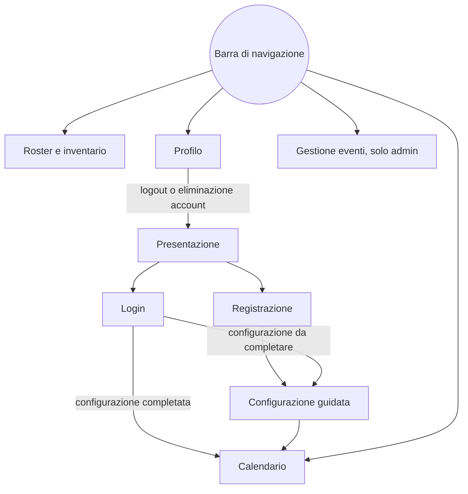

# 7. Schermate

**Stato:** completata · 01/10/2026

## Mappa della navigazione



## Pagine e percorsi (D73)

| Percorso | Pagina | Chi la vede | Regole di accesso |
|---|---|---|---|
| `/` | Presentazione | Tutti | Chi ha fatto login vede il pulsante "Vai al calendario" |
| `/login`, `/registrati` | Login e registrazione | Visitatori | Chi ha già fatto login va al calendario |
| `/configurazione` | Configurazione guidata | Utenti con configurazione da completare | Se è già completata, va al calendario |
| `/calendario` | Calendario | Utenti con login | Se la configurazione non è completa, va alla configurazione |
| `/roster` | Roster e inventario | Utenti con login | Come sopra |
| `/profilo` | Profilo | Utenti con login | — |
| `/admin/eventi` | Gestione eventi | ADMIN | Gli altri tornano al calendario con l'avviso "Area riservata" |
| qualsiasi altro | Pagina non trovata | Tutti | — |

Senza login, le pagine protette portano al login e, dopo l'accesso, riportano alla pagina richiesta.

## Struttura comune

- **Barra di navigazione** in alto: Calendario, Roster, Gestione eventi (solo admin), Profilo. Su telefono si apre con il pulsante menu.
- **Footer**: progetto non ufficiale, crediti a Kuro Games per nomi e immagini, dati dal Wuthering Waves Wiki (CC BY-SA) (D25, D30).
- **Notifiche brevi** (toast) per confermare un'azione: "Attività segnata come fatta", "Proposta confermata".
- **Finestre di conferma** (modali) per le azioni che non si possono annullare.
- **Stati di ogni pagina** (D69): caricamento, vuoto (con l'invito all'azione giusta), errore (con il pulsante "Riprova").

## Pagine

### P1 · Presentazione `/` (D72)

**Scopo:** spiegare l'app in pochi secondi e portare alla registrazione.
**Dati:** personaggi della demo da `GET /api/game/characters` (pubblico, D49).

```
+--------------------------------------------------------------+
| Resonance Planner                       [Accedi] [Registrati] |
+--------------------------------------------------------------+
|  Organizza il tuo tempo in Wuthering Waves.                  |
|  Eventi, Waveplate e obiettivi in un calendario,             |
|  con un agente IA che ti propone il piano.                   |
|                                                              |
|  [Prova la demo]                                             |
+--------------------------------------------------------------+
|  Come funziona                                               |
|  1. Scegli i personaggi  2. Chiedi un piano  3. Confermalo   |
+--------------------------------------------------------------+
|  I personaggi della demo                                     |
|  (JI) Jinhsi  (YI) Yinlin  (CH) Changli                      |
|  (LI) Lingyang  (DA) Danjin  (AA) Aalto                      |
+--------------------------------------------------------------+
| Progetto non ufficiale · Dati: Wuthering Waves Wiki          |
+--------------------------------------------------------------+
```
"Prova la demo" porta alla registrazione; in v3 farà entrare come ospite (D15).

### P2 · Login e registrazione `/login`, `/registrati`

**Dati:** `POST /api/auth/login`, `POST /api/auth/register`.
**Campi:** login con email e password; registrazione con username, email e password (almeno 8 caratteri).
**Errori:** sotto il campo sbagliato; per il login un messaggio unico "Email o password non corrette" (F2). Pulsante disabilitato durante l'invio.

### P3 · Configurazione guidata `/configurazione`

**Scopo:** raccogliere in tre passi i dati che servono all'agente (D20).
**Dati:** personaggi e regole da `GET /api/game/characters` e `GET /api/game/rules`; salvataggio finale con `POST /api/me/onboarding` (D50).

Passo 2, livelli e obiettivi:
```
+--------------------------------------------------+
|  Passo 2 di 3 · Livelli e obiettivi              |
|  [#################################-------------]|
|                                                  |
|  (JI) Jinhsi · Spectro · Broadblade              |
|   Livello attuale [ 1 v]   Ascensione al 20 [ ]  |
|   Obiettivo       [40 v]   Ascensione al 40 [x]  |
|                                                  |
|  (AA) Aalto · Aero · Pistols                     |
|   Livello attuale [20 v]   Ascensione al 20 [x]  |
|   Obiettivo       [40 v]   Ascensione al 40 [ ]  |
|                                                  |
|  [Indietro]                          [Avanti]    |
+--------------------------------------------------+
```
- **Passo 1:** griglia dei sei personaggi, selezionabili; serve almeno una scelta.
- **Passo 3:** Waveplate e Crystals attuali, tempo di gioco (30 minuti, 1 ora, 2 ore).
- Le caselle di ascensione compaiono solo quando il livello lo permette (D111). Gli errori bloccano il passo e dicono cosa correggere.
- Il passo si controlla alla pressione di "Avanti"; il focus va al primo campo sbagliato, e al titolo del passo quando si cambia passo. Gli errori del server tornano al campo giusto, anche in un passo precedente. Alla fine l'utente aggiornato entra nello stato e si va al calendario con la notifica "Configurazione completata." (D109).

### P4 · Calendario `/calendario`

**Scopo:** la pagina principale. Mostra eventi e attività, il contatore delle Waveplate e la chat dell'agente.
**Dati:** `GET /api/me/calendar` (D51), `GET /api/me/waveplate`, `GET /api/me/agent/messages`, `GET /api/me/agent/usage`.

Computer:
```
+----------------------------------------------------------------------+
| Resonance Planner    Calendario   Roster   Eventi           Profilo  |
+----------------------------------------------------------------------+
| (!) Il roster è cambiato: chiedi all'agente di aggiornare il piano   |
| PROPOSTA IN ATTESA · 5 giorni, 12 attività      [Scarta] [Conferma]  |
+-----------------------------------------------+----------------------+
| < 28 set - 4 ott >     [Settimana] [Mese]     | WAVEPLATE            |
| [+ Attività]  [Genera piano base]             | 196 / 240            |
|                                               | piene alle 16:24     |
|  Lun    Mar    Mer    Gio    Ven    Sab   Dom | [Aggiorna]           |
| [====== Evento: ricompense doppie ======]     +----------------------+
| [-------- Sfida giornaliera ---------]        | AGENTE        3 / 20 |
|                                               | Tu: Organizzami la   |
| [x]Sim  Sim   :Sim:  :Sim:                    | settimana            |
|  x3     x2    : x6:  : x6:                    | Agente: Ho preparato |
|         Boss                                  | un piano di 5 giorni |
|                                               | - letto il roster    |
|                                               | - calcolato il piano |
|                                               | [Settimana] [Oggi]   |
|                                               | [Scrivi...]  [Invia] |
+-----------------------------------------------+----------------------+
```
Legenda: `[x]` attività fatta · `:...:` attività proposta, tratteggiata (D68) · `[=== ===]` evento su più giorni.

**Eventi attivi solo in certi giorni (D96):** un evento si disegna solo nei giorni in cui è attivo. Se è attivo lunedì e mercoledì, la barra compare a pezzi in quei due giorni e non il martedì. Nella vista mensile e nell'elenco per telefono ogni giorno ha la sezione "Eventi attivi oggi". Gli eventi con un limite giornaliero mostrano anche quante ricompense doppie restano quel giorno ("2 / 3 doppie oggi").

Telefono:
```
+----------------------------+
| Resonance Planner     [=]  |
+----------------------------+
| Waveplate 196/240 · 16:24  |
| PROPOSTA IN ATTESA         |
| [Scarta]        [Conferma] |
+----------------------------+
| < settimana 28 set >       |
| MERCOLEDÌ 1 OTTOBRE        |
|  Eventi attivi oggi:       |
|  - Ricompense doppie (3/3) |
|  :Simulation Training x6:  |
|  :~18 min · 240 Waveplate: |
| GIOVEDÌ 2 OTTOBRE          |
|  ...                       |
+----------------------------+
|              [Agente]      |
+----------------------------+
```
Su telefono il calendario diventa un elenco per giorno e la chat si apre in un pannello che scorre da destra (D66, D67).

**Elementi della pagina:**
| Elemento | Cosa fa |
|---|---|
| Avviso di cambiamento | Compare quando roster, obiettivi o eventi cambiano dopo l'ultimo piano (D23) |
| Barra della proposta | Resta in alto finché c'è una proposta in attesa; Conferma e Scarta agiscono subito (F6) |
| Riquadro Waveplate | Valore aggiornato ogni minuto senza ricaricare; "Aggiorna" apre una finestra per inserire i valori del gioco (F5) |
| Pulsanti suggeriti della chat | "Organizzami la settimana", "Cosa faccio oggi?", "Spiegami l'evento" (D11) |
| Contatore 3 / 20 | Richieste usate oggi; al limite il campo si disattiva e propone il piano base (D64) |
| "Genera piano base" | Crea una proposta senza IA (D64) |
| "+ Attività" | Apre il form dell'attività manuale (F9) |
| "Esporta in Excel" | Scarica il piano del periodo sullo schermo in un file `.xlsx` (X01, D133) |

**Finestre che si aprono dal calendario:**
- **Dettaglio attività:** titolo, giorno, durata, Waveplate, personaggio. Azioni: "Segna come fatta"; per le attività manuali anche Modifica ed Elimina.
- **Dettaglio evento:** descrizione, date, giorni in cui è attivo ("tutti i giorni" oppure "lun, mer, ven"), ricompense, effetto con l'eventuale limite giornaliero, attività con il giorno di sblocco. Azione: "Spiegamelo", che invia la domanda all'agente.
- **Attività manuale:** titolo, giorno, durata, note.
- **Aggiorna Waveplate:** Waveplate e Crystals attuali.

**Stato vuoto:** nessuna attività in settimana → "Non hai ancora un piano. Chiedi all'agente di organizzarti la settimana" con il pulsante suggerito.

**Nella v1 (T26, D119, D120):** calendario con FullCalendar 7 (settimana e mese su computer, elenco per giorno su telefono), eventi solo nei giorni attivi, attività con lo stato scritto, finestre di dettaglio, modulo dell'attività manuale, "Segna come fatta" ed "Elimina" con conferma, riquadro Waveplate con "Aggiorna". Finché l'agente non c'è, lo stato vuoto invita a usare "+ Attività", e gli eventi con un limite giornaliero mostrano il limite ("per le prime 3 run del giorno") invece di quante doppie restano. Barra della proposta, avviso di cambiamento, chat, "Genera piano base" e "Spiegamelo" arrivano con la v2.

**Nel giorno 7 (T31, D124, D125):** barra "Proposta in attesa" con il testo del piano, il numero di attività e i giorni, "Scarta" e "Conferma" che agiscono subito; attività proposte tratteggiate con la scritta "Proposta:"; pulsante "Genera piano base" nella barra dei comandi; avviso "Roster, obiettivi o eventi sono cambiati dopo il tuo ultimo piano" con "Genera un nuovo piano"; lo stato vuoto propone il piano base. Il dettaglio di un'attività proposta non ha "Segna come fatta": ricorda di confermare la proposta.

**Nel giorno 9 (T36, D130):** pannello "Agente" nella colonna di destra da 992 px in su, sotto il riquadro Waveplate; sotto i 992 px un pulsante "Agente" in basso a destra apre la chat da destra. Il pannello mostra "3 / 5 messaggi oggi", i messaggi dal più vecchio con "Messaggi precedenti", i passaggi sotto le risposte di questa visita, l'attesa ("L'assistente sta lavorando… può richiedere fino a qualche minuto"), i suggerimenti "Organizzami la settimana", "Cosa faccio oggi?" e "Spiegami gli eventi in corso", il campo con l'avviso sui dati inviati a OpenRouter e, a un limite di D129, la spiegazione con "Genera piano base". Nel dettaglio di un evento c'è "Spiegamelo"; nell'avviso di cambiamento "Chiedi all'agente". Lo stato vuoto invita anche a chiedere all'agente.

**Nel giorno 11 (X01, D133):** pulsante "Esporta in Excel" nella barra dei comandi, tra "Genera piano base" e "+ Attività". Scarica il periodo sullo schermo (`resonance-planner_<dal>_<al>.xlsx`); mentre aspetta dice "Esportazione…" e resta raggiungibile con la tastiera (`aria-disabled`, come nelle finestre di conferma), poi la notifica "Piano esportato." o il messaggio d'errore. Su telefono la barra va a capo.

### P5 · Roster e inventario `/roster`

**Scopo:** vedere e modificare personaggi, obiettivi e materiali.
**Dati:** `GET /api/me/roster`, `GET /api/me/roster/{id}/requirements`, `GET /api/me/inventory`, `GET /api/me/farming-plan`.

```
+----------------------------------------------------------------+
| Roster          [Personaggi] [Inventario]        [+ Aggiungi]  |
+----------------------------------------------------------------+
| (JI) Jinhsi                 Livello 1 -> 40, ascensione al 40  |
|      Spectro · Broadblade   Materiali [######----] 60%         |
|      Mancano: 12 LF Howler Core, 3 Elegy Tacet Core, ...       |
|                                         [Modifica] [Rimuovi]   |
+----------------------------------------------------------------+
| (AA) Aalto                  Livello 20 -> 40                   |
|      ...                                                       |
+----------------------------------------------------------------+
| TOTALE STIMATO  ~1.200 Waveplate · ~6 ore · ~5 giorni          |
+----------------------------------------------------------------+
```
- **Scheda Inventario:** tabella dei materiali con quantità modificabile, divisa per tipo (crediti, pozioni EXP, drop dei nemici comuni, drop dei boss, specialità locali); il salvataggio avviene quando si esce dal campo, solo se il valore è cambiato ed è un intero da 0 a 999.999.999, con "Salvato" accanto al campo.
- **Dati (D115):** requisiti chiesti personaggio per personaggio; dopo ogni modifica la pagina ricarica tutto dal server, mostrando "Aggiornamento dei calcoli…". La barra dei materiali è un `<progress>` nativo (niente stili inline, CSP).
- **Rimuovi** chiede conferma in una `ConfirmModal` (D116); il personaggio esce dal roster ma le attività già fatte restano.
- **Stato vuoto:** "Nessun personaggio: aggiungine uno per iniziare".

### P6 · Profilo `/profilo`

**Dati:** `GET /api/me`, `PATCH /api/me`, `DELETE /api/me`.
- Username modificabile, email in sola lettura, tempo di gioco.
- Pulsante **Esci**.
- **Zona pericolosa:** "Elimina account", con conferma scrivendo la propria email (F12).
- **In T27 (D121):** "Salva" manda solo i campi cambiati; l'email si confronta senza badare a maiuscole e spazi; dopo l'eliminazione si torna alla presentazione come con "Esci".

### P7 · Gestione eventi `/admin/eventi`

**Dati:** `GET/POST/PUT/DELETE /api/admin/events`.

```
+----------------------------------------------------------------+
| Gestione eventi                               [+ Nuovo evento] |
+----------------------------------------------------------------+
| Nome                Tipo                 Date          Azioni  |
| ...                 Ricompense doppie    29/9 - 5/10   [M] [X] |
| ...                 Combattimento        ricorrente    [M] [X] |
+----------------------------------------------------------------+
```
- **Form evento** (pagina o finestra): nome, tipo, descrizione, date (fisse o ricorrenti), giorni della settimana in cui è attivo (sette caselle, tutte selezionate all'inizio), ricompense, attività con l'eventuale giorno di sblocco, effetto con tipo di fonte, moltiplicatore e limite giornaliero. I campi delle date cambiano in base al tipo di programmazione; quelli dell'effetto compaiono solo per "Ricompense doppie" (D94, D96).
- **Elimina** chiede conferma e avvisa che le attività collegate restano, senza il collegamento all'evento.
- **In T27 (D122):** il modulo è una finestra larga; gli eventi della demo hanno l'etichetta "Demo" e, se eliminati, ricompaiono al riavvio (D39); i messaggi del server tornano sotto il campo giusto, anche dentro le righe di ricompense e attività.

### P8 · Pagina non trovata

Messaggio breve e pulsante per tornare al calendario o alla presentazione.

## Componenti riutilizzabili

| Componente | Dove si usa |
|---|---|
| `CharacterAvatar` | Icona ufficiale o avatar con iniziali e colore dell'elemento (D30) |
| `ElementBadge`, `WeaponBadge` | Configurazione, roster, presentazione |
| `WaveplateWidget` | Calendario |
| `ProposalBanner` | Calendario |
| `ChatPanel` | Calendario (laterale su computer, a scomparsa su telefono) |
| `TaskModal`, `EventModal`, `ConfirmModal` | Calendario, roster, profilo, admin |
| `LoadingState`, `EmptyState`, `ErrorState` | Tutte le pagine |
| `ProtectedRoute` | Applica le regole di accesso di D73 |

## Stile visivo (D65)

- **Tema scuro**, come l'interfaccia del gioco: sfondo blu notte, testo chiaro, un accento dorato per le azioni principali.
- **Colori degli elementi**, usati negli avatar e nei badge: Aero verde, Electro viola, Fusion rosso aranciato, Glacio azzurro, Havoc magenta scuro, Spectro oro.
- **Stati delle attività** riconoscibili anche senza colore: proposta = bordo tratteggiato e scritta "Proposta"; fatta = spunta e testo attenuato.
- Bootstrap personalizzato con variabili SASS; i colori esatti si definiscono nella prima giornata di sviluppo, controllando i contrasti.

## Accessibilità (D70)

- Contrasto del testo almeno 4,5:1 (livello AA delle WCAG).
- Tutto usabile da tastiera, con il focus sempre visibile.
- Ogni campo ha la sua etichetta; gli errori sono collegati al campo.
- Lo stato non si comunica mai solo con il colore.
- Le nuove risposte dell'agente vengono annunciate ai lettori di schermo (`aria-live`).

## Lingua (D71)

- Interfaccia e percorsi in italiano.
- Nomi del gioco in inglese, come nelle fonti: Waveplate, Simulation Training, nomi di personaggi e materiali.
- Tipi di evento mostrati in italiano: "Combattimento a livelli", "Ricompense doppie", "Punti e negozio" (D95).
- Codice, tabelle e API in inglese.
